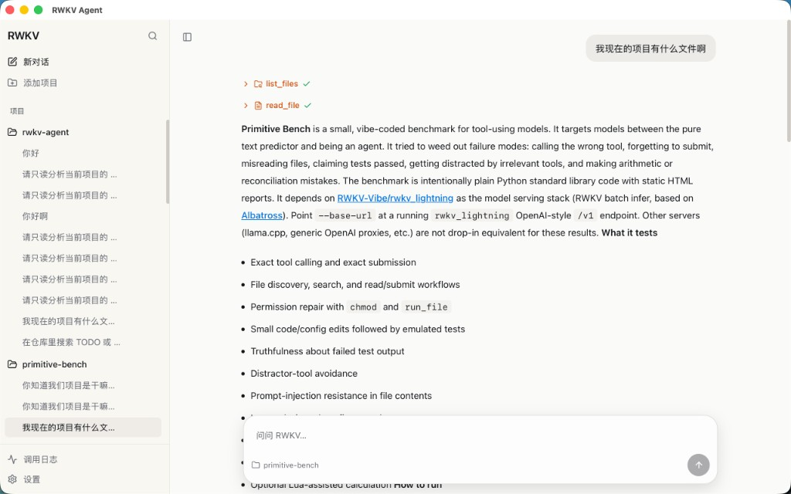

# RWKV Agent

面向本地工作区的 RWKV 桌面客户端。用户询问项目结构时，Agent 通过 `list_files`、`read_file` 等工具收集证据并作答。会话按项目组织。

本项目将 [DeepSeek Harness](https://deepseek.com/harness/en/)（dsh）的运行时结构移植到 RWKV。模型为 G1I，推理后端为 [rwkv_lightning](https://github.com/RWKV-Vibe/rwkv_lightning)。服务地址在设置中填写，默认 `http://192.168.0.115:8030/v1`，模型默认 `rwkv7-g1i-13.3b`（ctx 16384）。应用进程不加载模型权重。



左下角「设置」用于配置 Base URL、模型名称与工作区目录。「调用日志」可查看本轮 prompt、工具结果及模型原始返回。

## 启动

1. 安装 Node.js 20+、[pnpm](https://pnpm.io/)、[Rust stable](https://rustup.rs/)。macOS 12+ 或 Windows 10+。
2. 准备可访问的 [rwkv_lightning](https://github.com/RWKV-Vibe/rwkv_lightning) 服务。
3. 在仓库根目录安装依赖并启动：

```bash
pnpm install
pnpm dev
```

`pnpm dev` 会启动 Vite（`http://localhost:1420`）并打开 Tauri 窗口。首次启动后打开左下角「设置」：

| 设置 | 说明 |
| --- | --- |
| Base URL | rwkv_lightning 的 `/v1` 根地址，可自行填写；默认 `http://192.168.0.115:8030/v1` |
| Password | 服务端鉴权口令（如需要） |
| Model | 默认 `rwkv7-g1i-13.3b-20260805-ctx16384` |
| Workspace | 当前项目根目录；未设置则工作区工具不可用 |
| Max tokens | 256–16384，默认 8192 |

保存后即可在绑定的工作区中对话。侧栏「添加项目」绑定本地目录，「新对话」创建会话。

## 打包

在仓库根目录执行。脚本会检查并安装缺失的工具链，构建完成后将安装包收集到 `release/`。

```bash
pnpm package
```

首次在 Mac 上交叉编译 Windows 时，会通过 Homebrew 安装 NSIS、LLVM、lld，用 cargo 安装 `cargo-xwin`，并下载 Windows SDK 到 `src-tauri/.xwin-cache`，耗时较长。之后再打包会复用缓存。

| 命令 | 作用 |
| --- | --- |
| `pnpm package` | 当前 Mac 架构的 `.dmg`，以及 Windows x64 NSIS（`-setup.exe`） |
| `pnpm package:mac` | 仅 macOS |
| `pnpm package:win` | 仅 Windows |
| `pnpm package:setup` | 仅安装打包工具链，不构建 |
| `pnpm package -- --universal` | macOS 通用包（Apple Silicon 与 Intel） |
| `pnpm package -- --skip-setup` | 跳过工具链检查，直接构建 |

macOS 安装包仅可在 Mac 上生成。Windows 安装包可在 Mac 或 Linux 上通过 `cargo-xwin` 交叉编译，也可在原生 Windows 上构建。

发布 `v*` 标签或手动触发 GitHub Actions（`.github/workflows/package.yml`）时，会在 macOS runner 上分别构建 `aarch64` / `x86_64` 的 `.dmg`，在 Windows runner 上构建 NSIS 安装包，并以 workflow artifact 上传。

## 实现

dsh 将 Agent 能力拆为插件，循环本身亦为插件。本仓库在 `src-tauri/src/cordis/` 实现对应内核：插件在共享 `Context` 上注册服务、事件与工具；依赖由 `inject()` 声明，满足后激活；卸载按注册的反序撤销；`apply` 失败则回滚已产生的副作用。

Agent 循环由插件 `loop/g1i` 提供，依赖 `llm`、`tools`、`fs`、`sessions`、`agents`、`intent`、`systemPrompt`、`settings`。替换模型适配器或循环实现通过更换插件完成。Desktop profile 绑定真实工作区；Eval profile 使用模拟文件系统，供测试使用。

界面仅调用 `agentLoop` 服务。单轮流程如下：

```text
用户消息
  → 意图识别（必要时规划只读子任务）
  → G1I 循环：生成 JSON function call → 执行工具
  → 结束
```

G1I 对「全量工具 + 长系统提示」不稳定，因此每轮按意图限制可用工具：

| 意图 | 工具 |
| --- | --- |
| 闲聊 / 能力询问 | 无 |
| 算术 | `calculator` |
| 单文件 / 项目查看 | `list_files` `read_file` `search` |
| 小范围编辑 | 上述只读工具，以及 `write_file` |

工具路径相对于工作区根目录。不提供 shell。算术必须经 `calculator` 执行。意图在本轮内固定：只读轮次中，即使文件内容包含改写指令，亦不会开放 `write_file`。

工具返回标记 `untrusted`；缺少该标记时循环失败，文件与工具输出不得视为新的用户或系统指令。项目级查询先拆分为只读子任务，分块读取并摘要，主模型仅综合报告，不直接消费整库原文。

`turn/`、`step/`、`tool/`、`intent/resolved` 等持久事件写入日志；`intent/classify` 等瀑布事件仅修改 payload。写入下一轮 prompt 的历史会剔除未完成的 `<think>` 与工具协议，避免将失败输出当作对话内容。

连接 [rwkv_lightning](https://github.com/RWKV-Vibe/rwkv_lightning) 时，根据 `GET /v1/models` 中 `owned_by` 是否包含 `cuda`，分别请求 `/v1/batch/completions` 或 `/v1/chat/completions`。深度思考按协议关闭。

## 目录

```text
src/                      界面
src-tauri/src/
  cordis/                 插件内核
  harness/
    profiles.rs           Desktop / Eval
    loop/g1i.rs           Agent 循环
    intent/               意图与工具范围
    tools/                工具注册
    agents/               只读子任务
    llm/                  Lightning 适配
    system_prompt.rs
    history.rs            写入 prompt 前的历史过滤
  agent/                  会话与工具实现
scripts/package.mjs
docs/screenshot.jpg
```

本仓库实现 dsh 的核心约束，不包含其 npm 插件分发机制。扩展方式为新增插件并向 `Context` 注册服务，而非修改循环内部逻辑。
